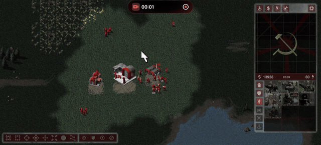

# OpenRA Red Alert for Android

A personal port of [OpenRA](https://github.com/OpenRA/OpenRA) to Android, based on the bleed branch at commit
[`b4d95a5`](https://github.com/OpenRA/OpenRA/commit/b4d95a56717d8d0070f195e343f6c2728ce87900) (November 2026), playing the Red Alert mod
with a Bluetooth controller using console-style controls inspired by the PlayStation version of Red Alert.

> **Made with Claude Code.** This port (the Android app, the engine changes, the native library builds and the
> controller controls) was written by [Claude Code](https://claude.com/claude-code), Anthropic's AI coding agent,
> directed and tested on a vivo x300 ultra, Samsung galaxy s23 Ultra, Pixel 8 Pro with a GameSir G8+ controller



*Skirmish on a vivo phone (Snapdragon, Android 16) with a GameSir G8+ controller.*

This is an unofficial fork. It is not endorsed by or affiliated with the OpenRA project or EA, and it does not
include any Red Alert game files: on first launch the game's content installer downloads the freeware files.

## Download and install

**APK: [`apk/OpenRA-RedAlert-android.apk`](apk/OpenRA-RedAlert-android.apk)**
([direct download](https://github.com/huggy12/OpenRA_Androidport-PSX-controls-/raw/main/apk/OpenRA-RedAlert-android.apk), about 39 MB)

1. Download the APK on your phone (or copy it over from a PC).
2. Open it and allow your browser / file manager to "install unknown apps" when Android asks.
3. Pair your Bluetooth controller in Android's Bluetooth settings, then start **OpenRA - Red Alert**.
4. On first launch choose **Quick Install** to download the freeware Red Alert game files (needs internet).

Requirements: a 64-bit ARM phone (arm64-v8a) running Android 7.0 or newer with OpenGL ES 3.0.
The APK is signed with a debug key, so Android may show an "unknown developer" warning.
It is built from the code in this repository; see [Controls](#controls) below for the controller layout.

## Updates

### 15 November 2026: app 1.0 (game version `playtest-20261026`)

Install the new APK over the old one; your settings and downloaded game files are kept. The first time it starts,
the setup screen appears once more so you can find the new **Touch Controls** option.

**Controller changes**
- **Special abilities** (paratroopers, spy plane, atom bomb...) can now be used with a controller: press
  **Triangle / Y twice quickly** to jump to them. Pick one with Cross / A and the cursor returns to the map to aim it.
  From the abilities you can step across to the build sidebar or down to the unit command bar.
- **Circle / B** now **deselects units** on the map (it still cancels building placement, sell mode etc. first,
  goes back in menus, and holds / cancels production in the sidebar).
- **L2 / LT** now jumps to the **unit command bar** at the bottom of the screen (this used to be on Circle / B).
- **R3** now selects all units on screen (this used to be on L2 / LT).
- **New Settings > Controller tab:** choose which button does each action. Picking a button that is already in
  use swaps the two; **Reset** restores the default layout.

**Touch controls (new)**
- Turn on **Touch Controls** in Settings > Input or on the setup screen. Tap to select or move units, tap and hold
  to attack-move, drag one finger to scroll the map, use two fingers to drag a selection box, and touch the
  minimap to move the view there. See [Touch controls](#touch-controls) below for details.
- The cursor and screen-edge scrolling are hidden while you use touch, and the sidebar and command bar stay fully
  visible instead of fading.

**Fixes**
- Fixed a crash when placing walls / fences (and other cases where the game draws an empty image).
- The Touch Controls checkbox on the setup screen no longer overlaps the control-scheme description.

**Version and online play**
- The game now shows its version as **`playtest-20261026`** instead of `{DEV_VERSION}`. The engine has the same
  gameplay code as the PC test build `playtest-20261026`, so it should be able to play online with PC players on
  that build. It can't join the main PC release (`release-20250330`), which is an older, incompatible version.
  Online play hasn't been tested yet.
- The Android app version (shown in Android's app info) is now 1.0.

## Controls

The controls follow the PlayStation version of Red Alert: one button selects and gives orders, and the
build sidebar is opened with Triangle. Tested with a GameSir G8+; any Android-compatible Bluetooth or USB
controller should work.

| PlayStation | Xbox | Action |
|---|---|---|
| Left stick | Left stick | **Map:** move the cursor. Push it against a screen edge (or the sidebar / command bar) to scroll the map. **Menus, sidebar, command bar:** the cursor is locked to the buttons; push in a direction to step to the next one |
| D-pad | D-pad | Same as the left stick (one button per press in menus) |
| Right stick | Right stick | Scroll the map (scrolls lists in menus) |
| Cross | A | Select units and give orders (move, attack, deploy, place buildings). Hold and move to drag a selection box. Tap twice on a unit to select all units of that type |
| Circle | B | **Map:** cancel the current mode (building placement, sell, attack-move...), otherwise deselect units. **Command bar / special abilities:** back to the map. **Sidebar:** hold / cancel production. **Menus:** back |
| Square | X | Cycle repair, sell, power down, then back to normal |
| Triangle | Y | Jump into the build sidebar; press again to return to the map. **Press twice quickly** to jump to the special abilities (paratroopers, spy plane, atom bomb...) when you have any: pick one with Cross / A and the cursor returns to the map to aim it |
| L1 | LB | Next build tab (buildings, defences, infantry, vehicles, aircraft, naval) |
| R1 (hold) | RB (hold) | Fast cursor and faster map scrolling |
| L2 | LT | Jump into the unit command bar at the bottom of the screen; press again to return to the map |
| R2 | RT | Attack-move, then Cross / A on the target |
| L3 (press left stick) | LS | Deploy (e.g. unpack the MCV into a construction yard) |
| R3 (press right stick) | RS | Select all units on screen |
| Start / Options | Menu | Game menu (pause, settings, surrender) |
| Select / Share | View | Jump to your base |
| Phone back button | | Same as Escape |

**Getting started in a match:** the cursor starts in the middle of the screen next to your MCV. Press Cross / A
on the MCV to select it and again to deploy it (or press L3). Press Triangle / Y to jump into the build sidebar,
pick a building with Cross / A and wait for it to finish. Pick it up with Cross / A: the cursor jumps back to the
middle of the map so you can place it.

Notes:
- The sidebar and command bar are see-through while the cursor is on the map, and solid while you are using them.
- In menus, hold Cross / A to drag sliders and scrollbars.
- Without touch controls, a tap on the screen is a left click.
- With a controller connected the game always uses OpenRA's "Classic" mouse style, which the controls rely on.
- The buttons in the table are the defaults. Change them in **Settings > Controller**: pick a button for each action
  from its list (choosing one that is already in use swaps the two). The sticks and D-pad can't be changed.

### Online play

The game reports its version as `playtest-20261026`. The engine is a development snapshot from just after that
PC test build, with the same gameplay code, so it should be able to play online with PC players running
**playtest-20261026**. It can't play against the main PC release (`release-20250330`), which is a much older version.

### Touch controls

Turn on **Touch Controls** in Settings > Input, or on the setup screen shown at first launch (it is shown once more
after the November 2026 update so you can find the option).

| Gesture | Action |
|---|---|
| One finger tap | Select units, or move / give orders to the selected units. Tap twice to select all units of that type |
| Tap and hold | Attack-move the selected units to that spot |
| One finger drag | Scroll the map |
| Two fingers | Drag a selection box: it runs from the first finger to the second, and selects when you lift a finger |
| Touch the minimap (top right) | Move the view to that spot. Drag along the minimap to keep moving it |

On menus and the sidebar a tap is a click and a drag works sliders and scrollbars. Holding a finger on a
sidebar build icon puts production on hold / cancels it. Touch controls use the "Classic" mouse style and hide
the cursor until you use a controller or mouse again. They work together with a controller.

## Layout

| Path | Contents |
|------|----------|
| `OpenRA-bleed/OpenRA-bleed/` | The OpenRA engine, with Android and gamepad changes (see the second commit for the full diff) |
| `OpenRA.Android/` | The Android app (.NET 10 for Android): SDL activity, app entry point, packaging and phone test scripts. Its README lists the controller controls |
| `native/` | CMake projects and build script for the native libraries (SDL2, OpenAL Soft, FreeType, Lua 5.1 and the `libmain.so` bridge) |
| `scripts/setup-toolchain.sh` | Downloads the toolchain into `tools/` (not committed) |

## Building (Windows, Git Bash)

```bash
scripts/setup-toolchain.sh     # once: .NET 10 + Android workload, JDK 17, Android SDK/NDK, CMake, Ninja, library sources
native/build-native.sh         # once: native libraries for arm64-v8a
OpenRA.Android/build-apk.sh    # builds OpenRA.Android/bin/Release/net10.0-android/net.openra.android.ra-Signed.apk
```

With a phone connected over USB debugging, `OpenRA.Android/run-on-phone.sh` builds, installs, launches and reports crashes.
To publish a new build, copy the signed APK over `apk/OpenRA-RedAlert-android.apk` and commit it.

## Engine changes

- Android support: platform detection, bundled assembly loading, GLES 3 window setup, UI scaling for phone screens,
  dialogs shrunk to fit, high precision shaders, Mono runtime workarounds
- Gamepad input (`OpenRA.Platforms.Default/Sdl2GamepadInput.cs`, `OpenRA.Game/Widgets/GamepadNavigation.cs`):
  virtual cursor, button snapping in menus, sidebar / command bar / support power zones (Triangle, L2, Triangle twice),
  push-to-edge scrolling, translucent HUD panels when not in use, remappable buttons (`GamepadSettings` in
  `OpenRA.Game/Settings.cs`, Settings > Controller panel in `ControllerSettingsLogic.cs`)
- Touch controls (`OpenRA.Platforms.Default/Sdl2TouchInput.cs`): tap, hold, drag and two-finger gestures, minimap
  view moves, enabled by the `TouchControls` setting
- Red Alert mod: production tab cycling and a repair / sell / power down cycling hotkey

## License

OpenRA is licensed under the GNU GPL v3 (see `OpenRA-bleed/OpenRA-bleed/COPYING`); the changes here are under the same license.
SDL2 (zlib), OpenAL Soft (LGPL), FreeType (FTL) and Lua (MIT) are built from their upstream sources.
